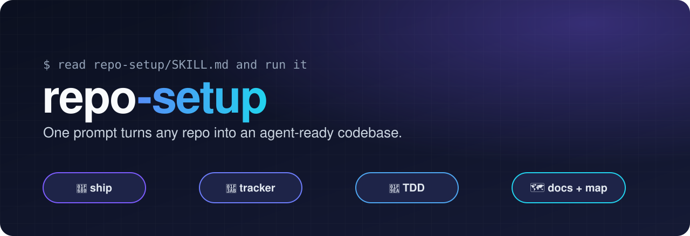
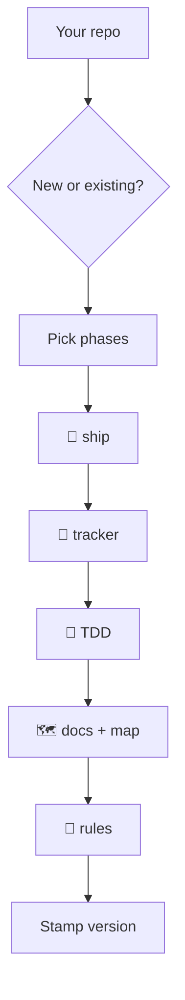

<p align="center">
  
</p>

<p align="center">
  
  
  
  
</p>

---

**repo-setup** is a skill for AI coding agents (built for [Claude Code](https://claude.com/claude-code)).
Point an agent at it from any repository, new or existing, and it brings that repo to a standard setup:
a review-and-ship pipeline, issue tracking, test-driven development, and docs an agent can navigate.

It is **repo-unaware**: nothing in here knows your project.
Everything repo-specific is asked interactively or inferred by scanning the code.

## ✨ What you get

| Phase | What lands in your repo |
| --- | --- |
| 🚀 **ship** | A `/ship` command: branch, commit, parallel multi-agent code review, fixes, lint/typecheck, docs update, push and PR. Configured per repo in `.agents/ship.md`. |
| 🎫 **tracker** | Issue tracking through the [Multica](https://github.com/multica-ai/multica) CLI, plus `to-tickets` and `triage` skills and a shared label vocabulary. |
| 🧪 **testing / TDD** | A testing skill with the red → green → refactor loop, test layers, and non-negotiable rules (no weakened tests, positive + negative twins). |
| 🗺️ **docs + code map** | A short `CLAUDE.md`, `AGENTS.md`, `CODING_STANDARDS.md`, ADR and glossary formats, and a code map (one card per noun, process and effect) so agents stop grepping blindly. |

On top of the phases:

- 📏 **Automated rules catalogue**: checks (tests, lint rules) for bug classes that review keeps missing, such as raw error messages reaching users or tests touching a hosted database. The agent proposes only the ones that fit your repo. See [`references/rules/`](references/rules/).
- 🔄 **Self-updating**: every set-up repo records the version it was set up with. `/ship` compares it with this repo and offers to apply what changed.

## ⚙️ How it works



1. The agent detects whether the repo is new or existing, and which phases are already done (those are skipped).
2. You confirm which phases to run. Every phase is self-contained and re-runnable on its own.
3. Each phase reads its reference in [`references/`](references/), copies the [`templates/`](templates/) and fills the `{{PLACEHOLDERS}}` by asking you a few questions at a time.
4. It never commits in your repo unless you ask: it lists the files it created instead.

## 🚀 Setup

Clone it anywhere outside your projects. Below, `<REPO_SETUP_DIR>` is the folder you cloned into:

```bash
git clone https://github.com/Geghi/repo-setup <REPO_SETUP_DIR>
```

> [!IMPORTANT]
> Replace the default path with your `<REPO_SETUP_DIR>` in
> [`templates/skills/ship/SKILL.md`](templates/skills/ship/SKILL.md) (step 0, "Version check").
> The generated `/ship` reads this repo from there to check for updates;
> with the wrong path, setup still works but the update check skips silently.

Then, from the root of the repo you want to set up, tell your agent:

```text
read <REPO_SETUP_DIR>/SKILL.md and run it
```

Only one phase? Add it: `… and run only the docs phase`.

> [!TIP]
> It is deliberately **not** installed in `~/.claude/skills/`, so it stays invisible to normal sessions and only runs when you call it.

## 📂 Layout

```text
SKILL.md          the orchestrator the agent follows
references/       one file per phase, plus the rules catalogue
templates/        files copied into the target repo
CHANGELOG.md      one line per version (top = current)
changelog/vN.md   what changed in vN and how a set-up repo catches up
```

## 🏷️ Versioning

Every change here is a new version: a line in [`CHANGELOG.md`](CHANGELOG.md) and a `changelog/vN.md` file.
A set-up repo stores its version in `.agents/repo-setup-version`, and `/ship` offers the missing upgrades oldest first.
