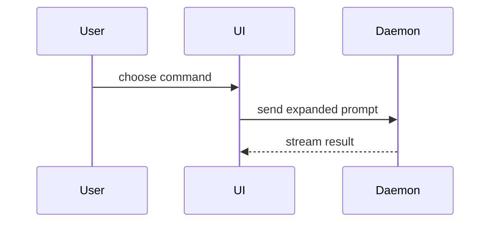

The body exists to decide the merge, not to retell the work.
The details stay in the commits, the tests and the ship report.
This skill is the only source for the body's format and length.
`docs/agents/evidence.md` says what counts as proof and how to capture it.

Budget: about 150–200 words, not counting captures and the one diagram.
Each behaviour is stated once, in one section.

```markdown
## Summary

<1–2 sentences: what changes for the user, in CONTEXT.md language>

<one diagram or diff sketch, ≤ ~10 lines — always>

## Evidence

**<one line: what this capture shows and what it proves>**
<the capture: image, video or audio, the kind `docs/agents/evidence.md` asks for>

- `<test file>`: <what it covers, one line>. Red before the change, green after.
- Gates green<, except: <name> — <why it is not this PR>>

## Merge Danger

**Door:** <one-way | two-way> · **Blast radius:** <scope, a few words>

Open:
- <what> → <plan> (`file:line`)

<tracker closing line, when `ship.md` Delivery requires one, always last>
```

## Summary

What the user sees or gets, not how the code does it.
Implementation details only when a reviewer would get the merge wrong without them.

Always one visual, the smallest that makes the point:

- Show logic or an algorithm as pseudocode:

```text
on(save)
  if content is unchanged
    return cached result
  write new content
  return fresh result
```

- Show runtime control flow as a call tree:

```text
submitForm
  createSession
    persistPrompt
    launchAgent
  navigateToSession
```

- Show UI structure as a component tree, including state and module boundaries that matter:

```text
<SessionPage> (apps/example/src/routes/session.tsx)
  useSessionEvents()
  <SessionToolbar>
    <RunSkillButton> (packages/ui)
```

- Show file responsibility or a broad refactor as a shallow file tree:

```text
src/
├── commands/       # parses user actions
├── sessions/       # owns session state
└── transport/      # sends API requests
```

- Show component interaction, control flow, or data flow with Mermaid:



- Use `diff` when the point is what changes and the surrounding shape already exists. Match the diff shape to the topic.

For a component change:

```diff
 <SessionPage>
   useSessionEvents()
   <SessionToolbar>
+    <RunSkillButton />
   <SessionTimeline>
+    <SkillResultCard />
```

For a file-layout change:

```diff
 src/
 ├── commands/
+│   └── show-me.ts       # expands the slash command
 ├── sessions/
-└── transport.ts
+└── transport/
+    ├── client.ts
+    └── stream.ts
```

For a call-tree or call-stack change:

```diff
 submitForm
   createSession
     persistPrompt
+    expandSkillMention
     launchAgent
-  navigateToSession
+  navigateToSession
+    subscribeToEvents
```

For a state or control-flow change:

```diff
 on(save)
-  write content
+  if content is unchanged
+    return cached result
+  write new content
+  invalidate cache
```

- Show the whole block when most of it is new, when omitted context would hide ownership or order, or when the user needs a copyable target shape:

```ts
function expandSkill(command: string): string {
  const skillName = command.slice(1);
  return `use the ${skillName} skill`;
}
```

Keep only the calls, files and states the point needs.

## Evidence

One entry per behaviour the PR claims: `behaviour → proof`.
- Behaviour a person sees or hears → the capture `docs/agents/evidence.md` asks for
  (screenshot, video, audio, generated file), with one caption line above it.
  Cover every such behaviour, including the default that must stay unchanged.
- No such behaviour in this repo (backend, CLI, library) → no captures.
- Not visible → the test (file + one line on what it covers), or a real request/response.
- What has no proof, one line: what and why.

Never: one block per test (name / asserts / why), formulas, the full list of gates, a "browser verify" section the captures already show.

## Merge Danger

Two-way door: cheap to roll back. One-way door: destructive or hard to reverse (data, migrations already applied, published contracts).
Blast radius: what can break if it is wrong (layout, consumers, mobile, …).

Open findings: one line each, with `file:line` and the plan.
A finding the user has decided says so (fixed here / moved to <ticket> / kept, why), never listed as open.
